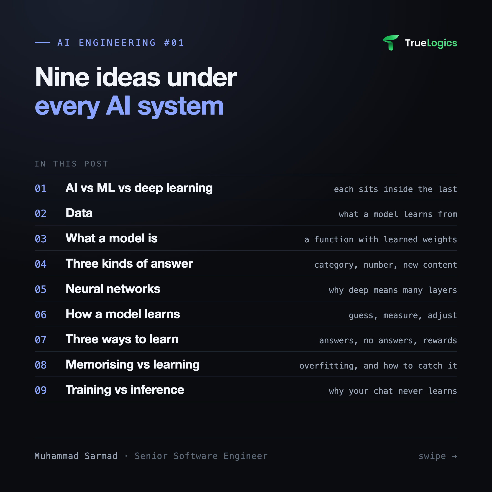
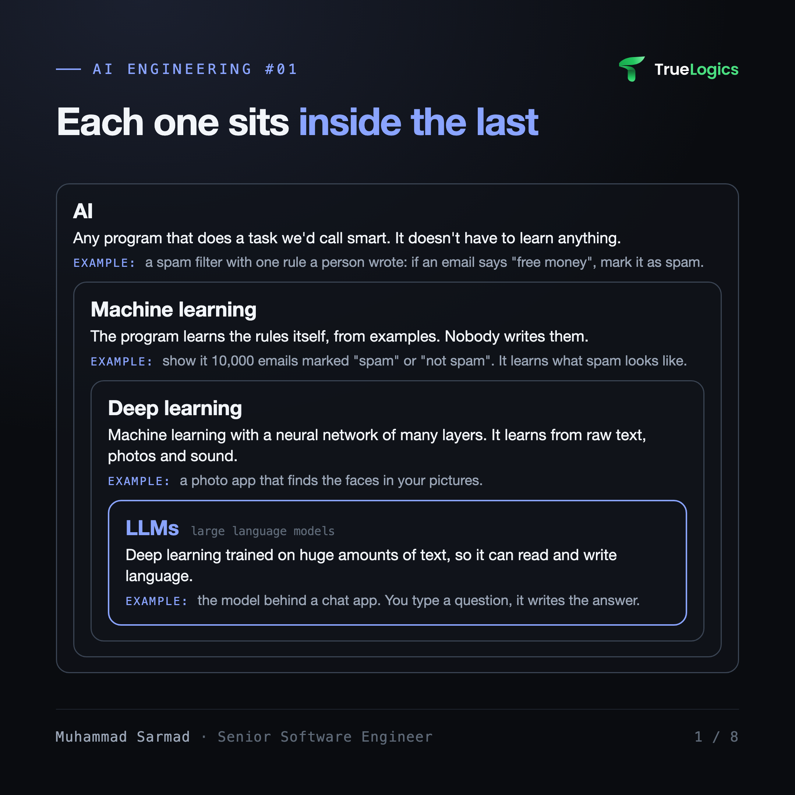
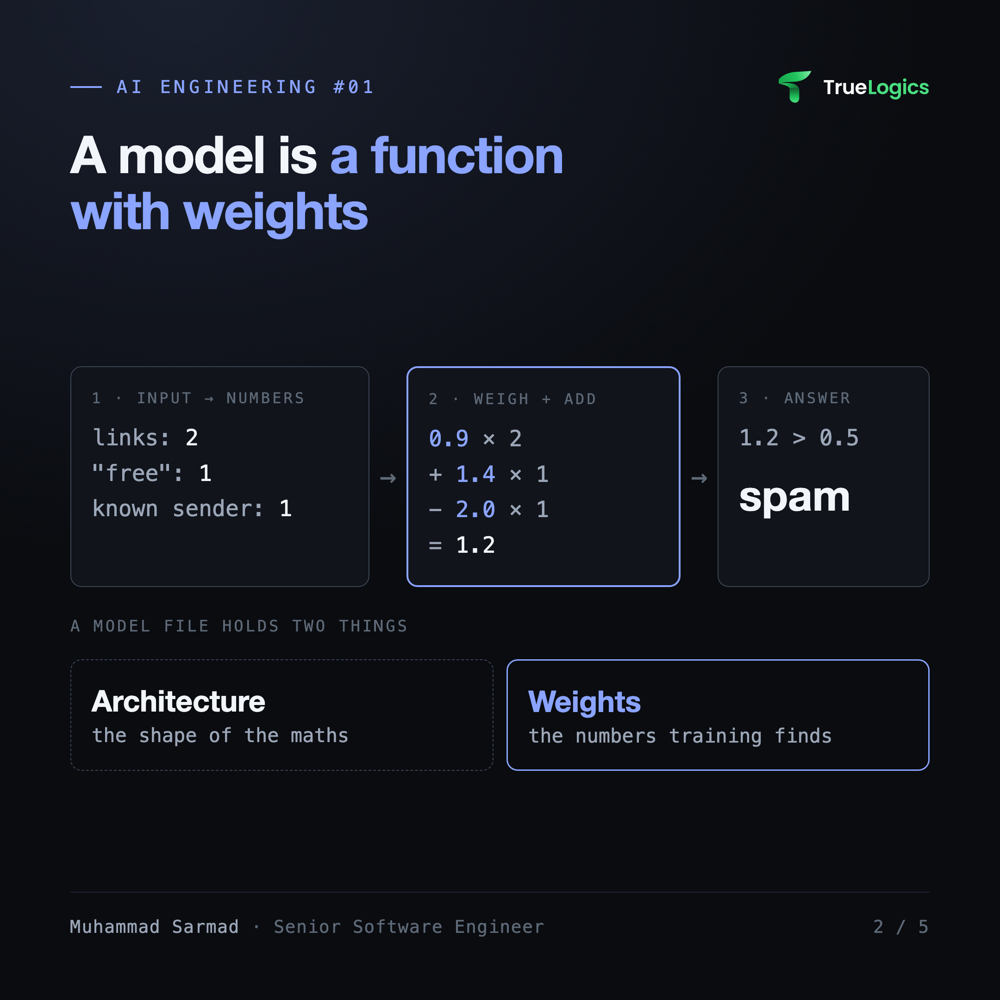
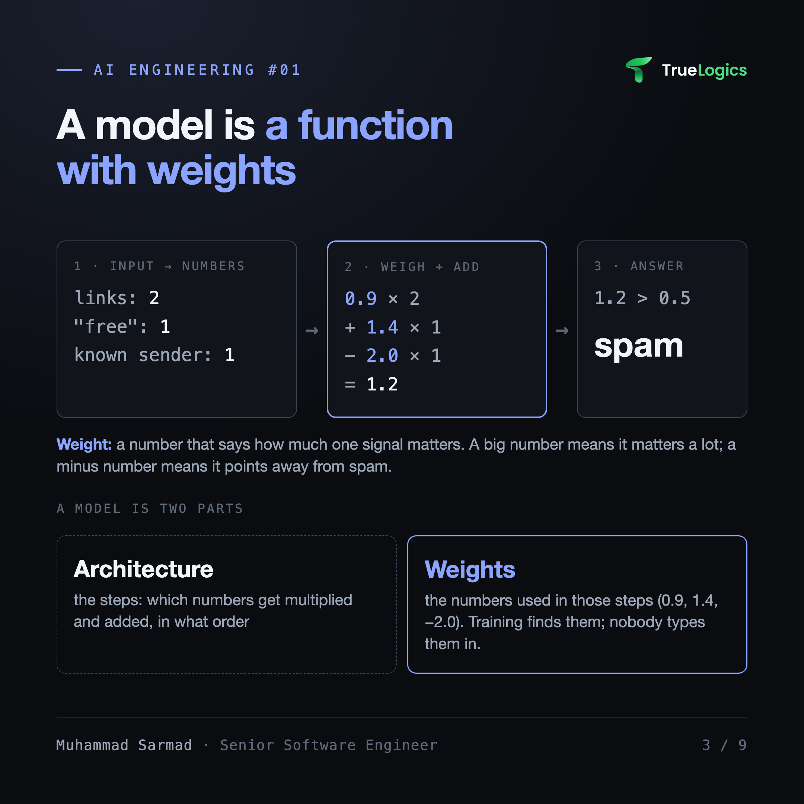
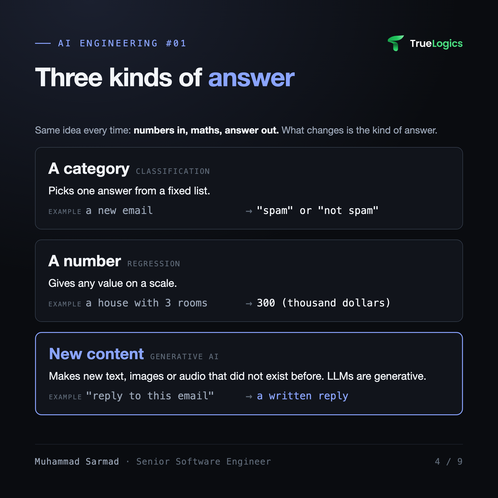
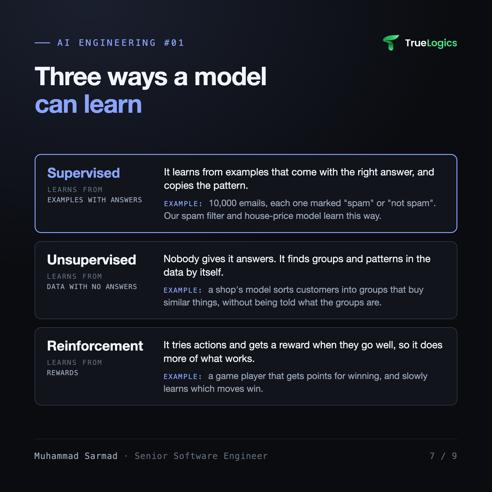
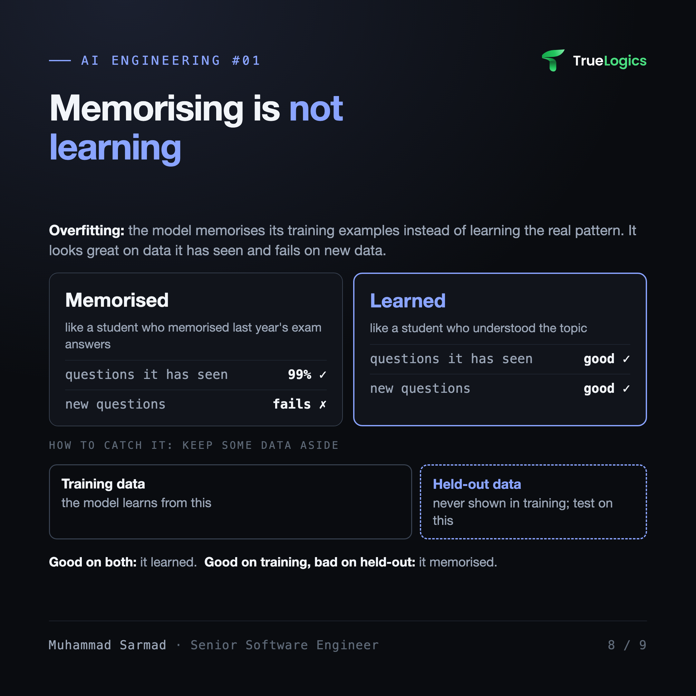

You correct a chat model. It says "thanks, noted". Tomorrow, in a new chat, it makes the same mistake again.

It did not forget. It never learned.

That sounds strange until you know five basic ideas. They sit under every AI system, from a spam filter to the largest chat model. This article explains them in order, with one simple example for each, so the rest of this series makes sense.

## What we'll cover

1. **AI vs ML vs deep learning:** three words people mix up, and how they fit together.
2. **What a model is:** a function with learned numbers inside it.
3. **Neural networks:** why "deep" just means many layers.
4. **How a model learns:** guess, measure, adjust, repeat. Plus the three ways to learn, and the memorising trap.
5. **Training vs inference:** how a trained model predicts, and why your chat never learns from you.

## 1. AI vs ML vs deep learning

These three words are not rivals. Each one sits inside the one before it. Let's use one job for all three: deciding if an email is spam.

**AI** is any system that does a task we would call smart. It does not have to learn anything. A hand-written rule counts:

- If the email says "free money", mark it as spam.

That is AI. It is also fragile. Spammers write "fr3e m0ney" and your rule misses it. You add another rule, then another, and you never catch up.

**Machine learning (ML)** flips this around. Instead of you writing the rules, the system learns them from examples. You give it 10,000 emails, each one labelled "spam" or "not spam". It works out by itself which signs point to spam: many links, certain words, unknown senders. When spammers change their tricks, you give it new examples, not new rules.

**Deep learning** is one kind of machine learning. It uses **neural networks** with many layers (section 3 explains what those are). Its big strength is that it works on raw data: plain text, images and audio. You don't have to tell it what to look at first; it finds that by itself.

**LLMs** (large language models, like the ones behind chat apps) are deep learning models trained on huge amounts of text.

So: every LLM is deep learning, all deep learning is machine learning, and all machine learning is AI. Not the other way round.

## 2. What a model is

"Model" sounds mysterious. It isn't. **A model is a function with learned numbers inside it.** Input goes in, maths happens, an answer comes out.

Here is a tiny spam model, step by step.

**Step 1: turn the input into numbers.** A computer can't do maths on an email, so we describe it with numbers:

- links in the email: 2
- times the word "free" appears: 1
- is the sender known? yes = 1

**Step 2: multiply each number by a weight and add them up.** A **weight** is a number that says how much one signal matters, and in which direction:

- links: weight 0.9 (more links, more likely spam)
- "free": weight 1.4 (a strong spam sign)
- known sender: weight −2.0 (negative, because a known sender makes spam less likely)

Score = 0.9 × 2 + 1.4 × 1 − 2.0 × 1 = 1.8 + 1.4 − 2.0 = **1.2**

**Step 3: turn the score into an answer.** Our rule: above 0.5 means spam. 1.2 is above 0.5, so this email is spam.

Now the important part: **nobody typed in 0.9, 1.4 or −2.0.** Training found them by looking at thousands of labelled emails. That is the "learning" in machine learning.

So a model is two things:

- the **architecture**: the shape of the maths (which numbers get multiplied and added, in what order)
- the **weights**: the numbers training found

Think of a recipe. The architecture is the list of steps. The weights are the amounts of each ingredient. Same steps with different amounts give you a different dish. Same architecture with different weights gives you a different model.

## 3. Neural networks

A **neural network** is the spam model's idea, repeated many times.

**A neuron** does exactly what our spam model did: multiply each input by a weight, add them up, then pass the result through a simple function. That function (called an **activation function**) is a small fixed rule, for example "if the result is below zero, use zero". It lets the network learn patterns that aren't straight lines.

**A layer** is many neurons side by side. They all look at the same input, but each has its own weights, so each one picks up a different pattern.

**A network** is layers stacked, each feeding its answers to the next. **Deep** just means many layers.

Why stack them? Because each layer builds on the one before it. In an image model that recognises faces:

- the **first layer** finds edges: lines and corners
- **middle layers** combine edges into shapes: an eye, a nose
- **late layers** combine shapes into faces

Nobody writes those rules. Nobody tells layer 1 "look for edges". That split comes out of training on its own.

**Why AI runs on GPUs:** all of this is the same simple step, multiply and add, done millions of times. Grouped together, that's called matrix multiplication. A CPU does a few of these at a time. A GPU does thousands in parallel. That's why AI needs GPUs.

## 4. How a model learns

Training is a loop, and you can follow it with a model that has just one weight.

**The model:** price = w × rooms. It predicts a house price from its number of rooms, and **w** is the only weight.

**The example:** a 3-room house that sold for 300.

1. **Guess.** w starts at 50, so the model says 50 × 3 = 150.
2. **Measure.** The real price is 300, so it is off by 150. This error is called the **loss**. Lower loss means a better model.
3. **Adjust.** The guess was too low, so raise w a little.
4. **Repeat.** Try again with the new w, measure again, adjust again, over many examples, many times. Slowly w climbs until it reaches 100. Now 100 × 3 = 300, and the loss is zero.

That's all training is: guess, measure, adjust, repeat.

A real model has billions of weights instead of one, so how does it know which ones to change? Two methods work together:

- **Backpropagation** works out how much each weight caused the error, like tracing back which ingredient made the dish too salty.
- **Gradient descent** then nudges each weight a little in the direction that lowers the loss.

### Three ways to learn

The loop above learned from labelled examples. That's one of three ways a model can learn:

- **Supervised:** from labelled examples. Emails marked "spam", houses with their prices.
- **Unsupervised:** from unlabelled data, by finding patterns on its own. For example, grouping customers who buy similar things, without being told the groups.
- **Reinforcement:** from rewards. The model tries actions and gets a reward for good ones, like a game player that gets points for winning.

### The trap: memorising instead of learning

A model can **memorise** its training examples instead of learning the real pattern. This is called **overfitting**.

Think of a student who memorises last year's exam answers. They score 99% on that paper and fail any new question. An overfit model is the same: nearly always right on examples it has seen, wrong on new ones.

How to catch it: before training, **keep some data aside** that the model never sees. After training, test on that held-out data.

- Good on both: it learned.
- Good on seen data, bad on held-out data: it memorised.

## 5. Training vs inference

A model has two very different moments in its life: first it learns, then it predicts. Section 4 showed the learning. Here is the predicting.

### How a model predicts

**Prediction** means giving the trained model a new input it has never seen, and getting an answer back. It uses the weights training found. It learns nothing new while it does this.

Take the house model from section 4. Training found w = 100. Now a new house comes along with 4 rooms. The model runs its maths: 100 × 4 = 400. It predicts a price of 400. The weight stays 100.

The spam model works the same way. A new email arrives: 0 links, no "free", from a known sender. With the same weights as before: 0.9 × 0 + 1.4 × 0 − 2.0 × 1 = −2.0. That is below 0.5, so the answer is "not spam".

Every model predicts like this, from the spam filter to the largest chat model: input becomes numbers, numbers are multiplied by weights and added up, and out comes an answer. A big model just has billions of weights instead of three.

### What changes and what doesn't

**Training** changes the weights. This is the loop from section 4. For a large model it is huge and rare: many GPUs running for weeks. Most teams never do it; model labs do it, then ship the finished weights.

**Inference** uses the weights, frozen. You send an input, the model runs its maths with the weights it already has, and you get an output. This happens on every API call. You pay per **token**: a small piece of text, about a word or part of one.

The key point: **at inference, the weights never change.** Nothing you type during a chat changes the model.

Now the opening puzzle makes sense. When you correct a chat model, it only *seems* to listen. A chat feels like it remembers because the app sends the whole conversation again with every new message. The model reads the full history each time, so your correction is in front of it. Start a new chat and that history is gone. The weights are the same as before, so it makes the same mistake.

That also explains why long chats cost more: every message sends all the earlier ones again, so you pay for those tokens again too.

**Fine-tuning** is extra training on an already-trained model, using your own examples. It gives you a new version of the model with new weights. It can help when you need a fixed style or format. But don't start there: most products only need inference. A good prompt with the right facts in it is cheaper and much easier to change.

## Try it on Optimal Lab

- [The context window](https://optimallab.dev/tracks/ai/context-window): watch a chat resend every message as it grows.
- [How text becomes tokens](https://optimallab.dev/tracks/ai/tokenization): type your own text and count the tokens.
- [How an LLM picks the next token](https://optimallab.dev/tracks/ai/next-token): one inference step, with temperature you can drag.

There's no interactive for training yet.

## Keep in mind when you start building with models

- The model won't learn from your chats. Send what it needs on every call.
- New facts go in the prompt, not the weights. The weights are fixed.
- Long chat history costs tokens on every call. Trim it.
- Test on data the model never saw, or you're only measuring its memory.
- Try prompts and examples before fine-tuning. It's cheaper.

**In one line:** a model is a function with learned weights. Training finds them. Inference uses them, on every call you pay for.

## Next in the series

What an LLM actually does at inference. Next-token prediction, plainly.
