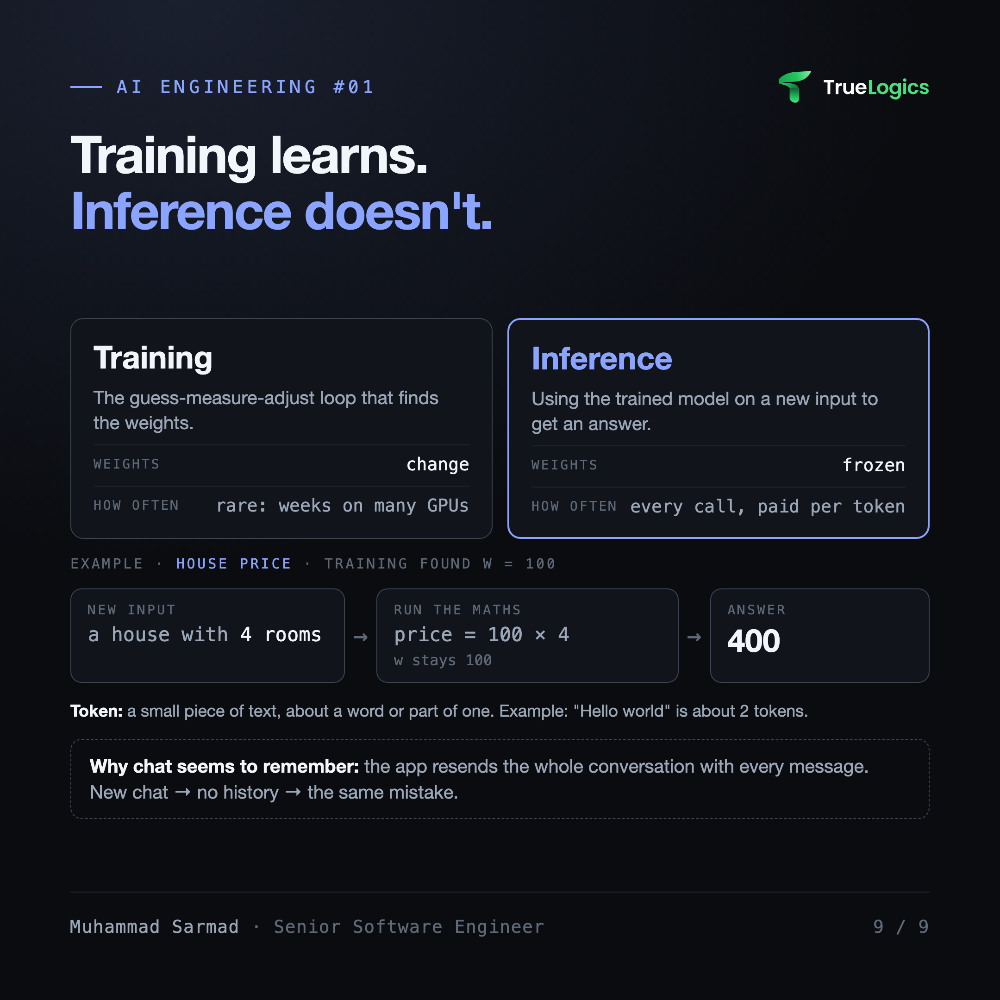

You correct a chat model. It says "thanks, noted". Tomorrow, in a new chat, it makes the same mistake.

It did not forget. It never learned.

That makes sense once you know nine basic ideas. They sit under every AI system, from a spam filter to the largest chat model. This article explains them in order, with one simple example each, before this series goes into LLMs.

## What we'll cover

1. **AI vs ML vs deep learning:** how the three words fit together.
2. **Data:** what a model learns from.
3. **What a model is:** a function with learned numbers inside.
4. **What a model can give back:** a category, a number, or new content.
5. **Neural networks:** why "deep" means many layers.
6. **How a model learns:** guess, measure, adjust.
7. **Three ways to learn:** with answers, without answers, from rewards.
8. **Memorising is not learning:** overfitting, and how to catch it.
9. **Training vs inference:** why your chat never learns from you.

## 1. AI vs ML vs deep learning

These words are not rivals. Each one sits inside the one before it.

- **AI** is any program that does a task we would call smart. It does not have to learn. A spam filter with one hand-written rule counts: if an email says "free money", mark it as spam.
- **Machine learning (ML)** learns the rules from examples instead of you writing them. Show it 10,000 emails marked "spam" or "not spam", and it finds what spam looks like.
- **Deep learning** is machine learning with neural networks of many layers. It learns straight from raw text, photos and sound, without people first deciding what to look for. A photo app that finds faces in your pictures uses it.
- **LLMs (large language models)** are deep learning models trained on huge amounts of text, so they can read and write language. The model behind a chat app is one.

## 2. Data: what a model learns from

Machine learning learns from examples. A set of examples is a **dataset**. For the spam filter it is a table with one row per email.

- **Features** are the facts about each example that the model gets as input: the number of links, whether it says "free", whether the sender is known.
- The **label** is the right answer for that example: "spam" or "not spam".

The model only knows what the data shows it. If half the labels are wrong, it learns the wrong pattern. If every training email is in English, it has no idea what Spanish spam looks like. Bad data in, bad model out, and no error message tells you.

## 3. What a model is

**A model is a function with learned numbers inside it.** Take the email "Claim your free prize": 2 links, says "free", from a saved contact.

1. **Input becomes numbers:** links = 2, "free" = 1, known sender = 1.
2. **Each number is multiplied by a weight and added up:** 0.9 × 2 + 1.4 × 1 − 2.0 × 1 = 1.2.
3. **The score becomes an answer:** the cut-off (threshold) is 0.5. 1.2 is above it, so: spam.

A **weight** is a number that says how much one signal matters. A big number means it matters a lot; a minus number pushes away from spam.

A model is two parts: the **architecture** (the steps: which numbers get multiplied and added, in what order) and the **weights** (the numbers used in those steps). Training finds the weights. Nobody types them in. All the learned numbers together are the model's **parameters**; a "7B model" has about 7 billion of them.

## 4. What a model can give back

The same idea (numbers in, maths, answer out) gives three kinds of answer:

- **A category (classification):** pick one from a fixed list. The spam filter answers "spam" or "not spam".
- **A number (regression):** any value on a scale. A house-price model looks at a house and answers 300 (thousand dollars).
- **New content (generative AI):** new text, images or audio that did not exist before. A chat app writing an email reply for you. LLMs are generative; how they write, one small piece at a time, is the next post.

## 5. Neural networks: why deep means many layers

- A **neuron** is the spam model's maths in one small unit: multiply inputs by weights, add them up, then a small fixed rule (an **activation function**) shapes the result.
- A **layer** is many neurons side by side. A network is layers stacked, each one feeding the next.
- **Deep** means many layers. In an image model, early layers tend to find edges, middle layers shapes, late layers whole faces. Nobody writes those rules; they come out of training.
- **Why GPUs:** all of this is multiply and add, billions of times for one answer from a big model. A GPU does thousands of those at once.

## 6. How a model learns: guess, measure, adjust

Take a tiny model: price = w × rooms. It has one weight, w. A 3-room house really costs 300.

1. **Guess:** w starts at 50, so 50 × 3 = 150.
2. **Measure:** 300 − 150 = 150. That gap is the **loss**: one number for how wrong the guess was.
3. **Adjust:** the guess was too low, so raise w a little.
4. **Repeat** over many examples, many times: w goes 50 → 70 → 85 → 95 → 100. Now 100 × 3 = 300.

The **gradient** says which way, and how strongly, each weight pushes the loss. The **learning rate** sets how big "a little" is: too big and w jumps past 100, too small and training takes forever. **Gradient descent** is this loop: compute the gradient, nudge every weight a little against it, repeat. **Backpropagation** is how a big network computes the gradient for millions of weights at once, working back from the loss through every layer.

## 7. Three ways a model can learn

- **Supervised:** learns from examples that come with the right answer. The spam filter and house-price model learn this way.
- **Unsupervised:** learns from data with no answers, finding groups by itself. A shop's model sorts customers into groups that buy similar things, without being told the groups.
- **Reinforcement:** learns from rewards. A game player gets points for winning and slowly learns which moves win.

## 8. Memorising is not learning

**Overfitting** is when a model memorises its training examples instead of learning the real pattern. Like a student who memorised last year's exam answers: 99% right on questions they have seen, lost on new ones. The opposite problem, **underfitting**, is a model too simple or trained too little: bad on both.

How to catch it: keep some data aside that the model never trains on (held-out data, often called the test set), and test on that. Good on training data but bad on held-out data means it memorised.

## 9. Training vs inference

- **Training** changes the weights. It is the loop from section 6. For a large model it is huge and rare: many GPUs running for weeks. Model labs do it; most teams never do.
- **Inference** uses the weights, frozen. You give the trained model a new input, it runs its maths, you get an answer. It learns nothing new. With w = 100, a 4-room house gives 100 × 4 = 400, and w stays 100. A new email with 0 links, no "free", from a known sender gives −2.0: below 0.5, so not spam.

Inference happens on every call, and every call costs compute: a big model runs billions of weights for each answer.

So the chat model never learned from your correction. A chat feels like it remembers because the app sends the whole conversation again with each message. New chat, no history, same mistake. Some apps also save notes about you and add them to the input, but that is still input. The weights never change.

**Fine-tuning** is more training on a trained model, with your own examples. It gives you a new version of the model. Don't start there: most products only need inference with good prompts.

## Try it on Optimal Lab

- [The context window](https://optimallab.dev/tracks/ai/context-window): watch a chat resend every message as it grows.
- [How text becomes tokens](https://optimallab.dev/tracks/ai/tokenization): type your own text and count the tokens (small pieces of text, about a word or part of one).
- [How an LLM picks the next token](https://optimallab.dev/tracks/ai/next-token): one inference step, with temperature you can drag.

There's no interactive for training yet.

## Keep in mind when you start building with models

- The model won't learn from use. Send what it needs on every call.
- New facts go in the input, not the weights. The weights are fixed.
- Long chat history goes out again on every call. Trim it.
- Test on data the model never saw, or you measure its memory.
- Try prompts and examples before fine-tuning. It is cheaper.

**In one line:** a model is a function with learned weights. Training finds them. Inference uses them, on every call.

## Next in the series

What an LLM actually does at inference. Next-token prediction, plainly.
